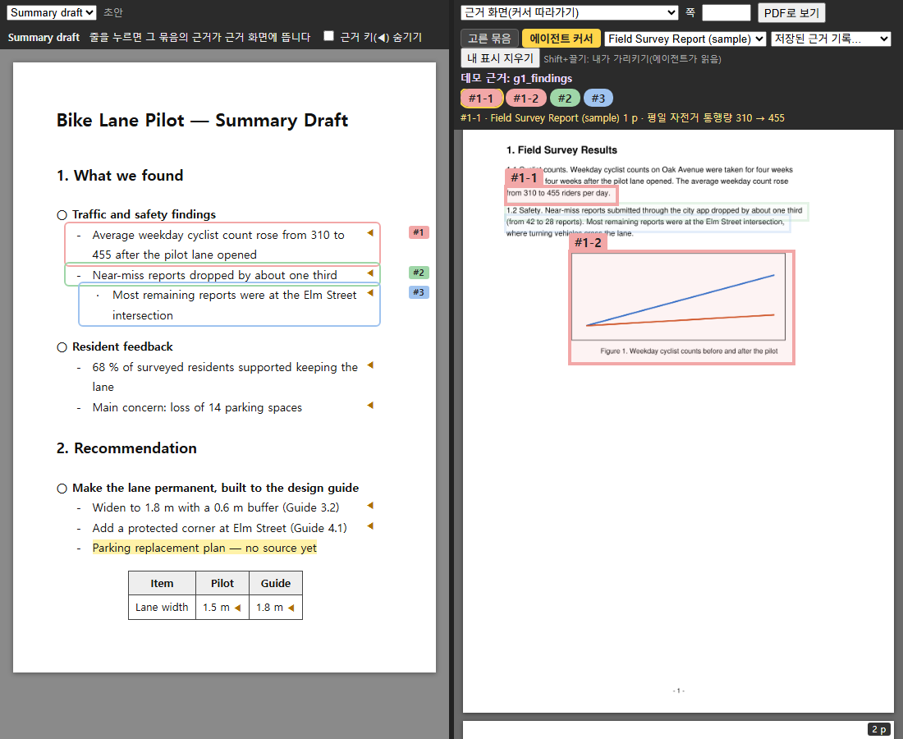

# evidence-viewer-kit

**English** | [한국어](README.ko.md)

A small toolkit for writing and reviewing documents where **every line of the draft is linked to its source** (PDF · page · box).
It is made for work where "where did this sentence come from?" matters: reports, proposals, literature notes, regulation reviews, meeting summaries.
It is built around a user and an AI agent looking at the same screen while they place and fix evidence together.



- **Live mode**: start a local server and you get the draft preview on the left and the evidence pane on the right. When the agent (or you) points at a source location with one command, the right pane jumps there and the matching draft line gets the same number.
- **Single-file mode**: bundle the current state into **one HTML file**. A reviewer double-clicks it — no server — and clicks lines to see their evidence.
- **Work while the user watches**: the agent works inside the apps the user already has open — **COM** for HWP/Excel/PowerPoint, **CDP** for the browser. The user sees each change as it happens and can step in at any time → [docs/WORKFLOW_TIPS.md](docs/WORKFLOW_TIPS.md)

> The on-screen labels are currently in Korean (e.g. `근거 1` = "evidence 1", `고른 묶음` = "selected group", `에이전트 커서` = "agent cursor").
> AGENTS.md and the files in `docs/` are written in Korean with an English summary at the top.

---

## 1. Quick start (demo)

```bash
pip install -r requirements.txt
python examples/demo/make_demo.py                     # creates 2 sample source PDFs + saved evidence
python -m evkit.serve --project examples/demo          # → http://127.0.0.1:8765/
python -m evkit.build_viewer --project examples/demo   # → examples/demo/.evkit/dist/*.html (single file)
```

Things to try in the demo
1. Click a line in the draft (left) → the evidence for that line's **group (○ item)** is collected on the right, and the lines get numbers `근거 1, 2, …`.
2. Click a number at the top right → the pane jumps to that box and the matching draft line is highlighted.
3. **Shift+drag** on a PDF page (right) → draws an orange "here" box. The agent reads its text and a cropped image with `python -m evkit.point --project … --show-user`.
4. Point at evidence from another terminal:
   ```bash
   python -m evkit.point --project examples/demo --msg "width rule" "guide|1|para=3.2 Width|[g3-1] 1.8 m width rule"
   ```

## 2. Use it for your own work

```
my-project/
├─ project.json          settings (below)
├─ docs/                 source PDFs (reports, papers, slides… export to PDF if needed)
├─ drafts/report.md      your draft
└─ .evkit/               auto-created: saved evidence, cache, single-file output (do not commit)
```

**project.json**
```json
{
  "title": "Project name",
  "docs": {
    "spec":  {"name": "Specification v2", "path": "docs/spec.pdf", "unit": " p"},
    "notes": {"name": "Meeting notes, March", "path": "docs/notes_0312.pdf", "first_page": 7}
  },
  "drafts": [{"label": "Report draft", "file": "drafts/report.md"}],
  "state_dir": ".evkit",
  "port": 8765,
  "page_dpi": 150,
  "skip_line_regex": "^- \\d+ -$",
  "math": false
}
```

| Key | Meaning |
|---|---|
| `docs.<key>` | A source document. Keep keys short (`spec`, `notes`, `ref1` …); commands and saved evidence refer to them |
| `first_page` | If the PDF is an excerpt, the original page number of its first page. Page numbers in commands are **original page numbers** |
| `crop` | (optional) area to show on every page, `[x0,y0,x1,y1]` in pt |
| `skip_line_regex` | lines to ignore when computing boxes (page numbers, running headers) |
| `math` | render `$…$` in drafts with MathJax (CDN) |

Instead of `--project` you can set the environment variable `EVKIT_PROJECT`, or run commands from the folder that contains `project.json`.

## 3. Draft syntax

```markdown
# Title
## 1. Section
○ Main item (a "group" runs from here to the next ○ or heading)
 - Sub item {@k1}
  · Detail {@k1-a}
Plain paragraphs work too {@k2}
| Table | Cell |
|---|---|
| value {@t1} | value |

**bold** {red}red{/red} {chg}green (changed){/chg} {todo}yellow (needs checking){/todo}
<!-- comment: hidden in the preview -->
```

- `{@key}` at the end of a line is the **draft key**. It links the line to saved evidence whose note starts with `"[key] …"`.
- Name keys however you like, but use **one key per line and never rename it** (renaming breaks the link). Examples: `y3-a1-2`, `s2.3-p1`.
- Groups start at `○` (or `■`, `□`) lines and at headings (`#` to `###`).

## 4. Pointing at evidence (`evkit.point`)

```bash
python -m evkit.point --project P --msg "what this shows" "docKey|page|where|[draftKey] note" ...
```

| `where` | Box covers |
|---|---|
| `find=text` | the **whole line(s)** containing the text. `find=A;;B` joins the A and B lines into one box |
| `para=text` | the **whole paragraph** containing the text |
| `sec=heading text` | from that heading to the next heading of the same level |
| `fig=caption text` | the figure above the caption + the caption (vector drawings included) |
| `after=text` / `before=text` | the figure/equation right below/above that line |
| `word=text` | just the matched text (e.g. a single number) |
| `box=x0,y0,x1,y1` | fractional page coordinates (0–1) |
| `page` | the whole page |

- Add `--check` to write a preview image with the boxes drawn to `.evkit/check/mark_N.png`. **If a box only catches a fragment of text or lands in the wrong place, fix it and point again.**
- `--clear` removes the current marks; `--show-user` prints the orange boxes the user drew.
- One line (key) can have several boxes; they are numbered `#3-1`, `#3-2`, …

## 5. Saving and replaying evidence (`evkit.pointer_log`)

```bash
python -m evkit.pointer_log --project P save ch2_groupA   # .evkit/history/ch2_groupA.json + .evkit/evidence_log.md
python -m evkit.pointer_log --project P show ch2_groupA   # show it again
python -m evkit.pointer_log --project P list
python -m evkit.check --project P                         # every bullet has a key, every key has saved evidence
```

- The group view (clicking a draft line) collects that group's keys from **all saved records**. If a key appears in several records, the **most recently saved** one wins.
- So the workflow is: point at one group's evidence → the user checks it → `save` → `evkit.check`. Repeat per group.
- `evkit.check` also flags **bullet lines without a `{@key}`**: clicking such a line shows nothing, so every bullet needs a key (use `{todo}` when no source can back it).

## 6. Two views

| View | When | Numbers |
|---|---|---|
| **Agent cursor** (`에이전트 커서`) | right after `point` (switches automatically) | `#1, #2 …` in pointing order (per key) |
| **Selected group** (`고른 묶음`) | when the user clicks a draft line | `근거 1, 2 …` counting only lines **that have evidence**, top to bottom within the group |

Evidence is drawn as a color fill plus a bar in the margin left of the text, with no top/bottom/right border (those ran over neighbouring text lines); the number lives only on the chip of the same color at the top. Clicking a chip gives its own box a bar in its chip color while every other bar turns light gray (so 2-1, 2-2, 2-3 of one key can be told apart) and outlines its draft line. Boxes that touch at an edge are trimmed so they do not overlap.

The draft and evidence panes number things with the same rule, and the view is switched in one place on the server (`/api/mode`) so both panes change together. When several lines point at the same paragraph and boxes overlap, the box for the current line is drawn on top and the others are dimmed.

## 7. Single file (`evkit.build_viewer`)

```bash
python -m evkit.build_viewer --project P [--out path.html] [--dpi 96] [--quality 60]
```

- Every page of every source document is embedded as JPEG, and the screens are the same code as live mode (`web/shim.js` answers the server requests).
- Size estimate: at 96 dpi / quality 60 an A4 page is about 100–150 KB, so ~300 pages is around 40 MB. Lower `--dpi`/`--quality` or drop unused documents from `docs` to shrink it.
- It is a snapshot. Rebuild when the draft changes.
- Math (`math: true`) uses the MathJax CDN, so the reader needs internet access.

## 8. Working together: user + agent

Give your agent (Claude, Codex, …) [AGENTS.md](AGENTS.md). In short:

1. **Reuse the source wording.** The agent does not invent sentences, headings or tables. Any connecting sentence it must add is marked.
2. **Every detail gets evidence.** Numbers, dates, status ("in progress") each link to a source location.
3. **Move the cursor whenever you mention a source.** Any answer that refers to a document also points at it with `point` — without asking first.
4. **The user decides.** A question is not a decision. When a decision is made, record it together with its evidence.
5. **Check and save group by group.**
6. **The draft holds everything; the chat only reports.** Every bullet links to evidence, the agent's `--msg` is a one-line progress note, and the viewer is opened with `python -m evkit.open` (a new window only if none is open; an open window reloads itself when the screen code changes). See AGENTS.md §0.

## 9. Other documents

- [AGENTS.md](AGENTS.md) — working rules and command summary for agents (hand it to the agent as is)
- [docs/WORKFLOW_TIPS.md](docs/WORKFLOW_TIPS.md) — an observable, interactive workspace: the agent works inside the apps the user has open (**COM** for Office/HWP, **CDP**/headless Chrome for the browser) and confirms results by what the user would see
- [docs/HWP_COM_NOTES.md](docs/HWP_COM_NOTES.md) — pitfalls and fixes when automating HWP (Hangul) and Excel via COM (Windows)
- [docs/DATA_FORMATS.md](docs/DATA_FORMATS.md) — formats of saved evidence, state files and the API

## 10. Security and sharing

- The server listens on `127.0.0.1` only and never serves files outside the project folder.
- **The single-file viewer contains full page images of your source documents.** If they are internal, send the file to specific people only and do not host it publicly.
- This repository holds the tool only. Do not commit your project's `docs/`, `drafts/` or `.evkit/` (see `.gitignore`).

## 11. Troubleshooting

| Symptom | Fix |
|---|---|
| The box covers the whole page ("글자를 찾지 못해…" = text not found) | Use a shorter piece of the exact source text (including spaces). For text that wraps, use the part on one line |
| The box is too wide | Use `word` instead of `find`, or text that appears only on that line |
| A figure is not caught | Try `fig=caption` or `before=caption`; otherwise use `box=` |
| Draft and evidence numbers differ | Reload both panes. Switch views with the buttons (they go through the server) |
| The right pane of the single file is blank | Check the browser console. If documents are large, rebuild with a lower `--dpi` |

## License

MIT — [LICENSE](LICENSE)
